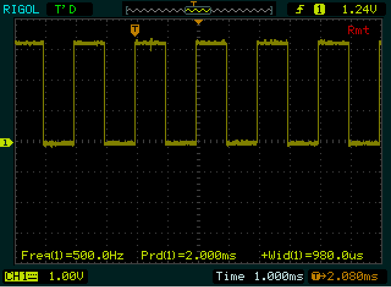
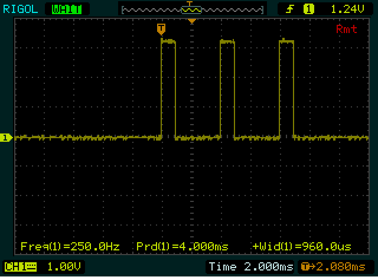
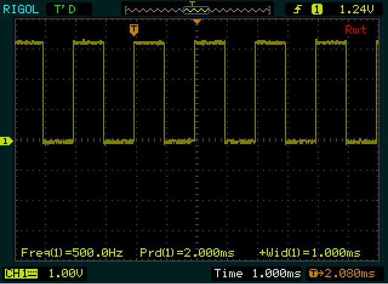
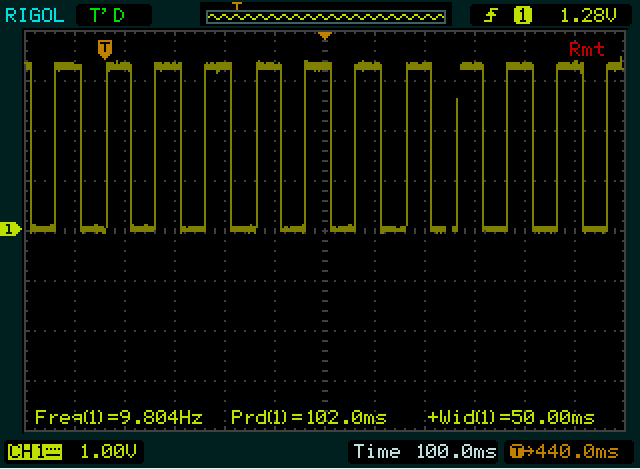
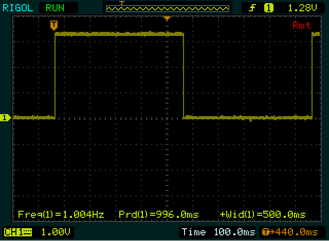

# Pulse Generator

## Table of Contents
- [Pulse Generator API](#Pulse-Generator-API)
- [API Examples](#api-examples)
- [Tools](#tools)

# Pulse Generator API
### generate_pulses(period_ms, width_ms, number_of_pulses = 0)  
> Generate pulses on pico's GP7 I/O line.   
period_ms - integer, minimum value is 2 msec.  
width_ms - integer, value < period_ms  
number_of_pulses - integer, specifies number of pulses, if = 0 then its a pulse waveform.  
**Beware:** Do not restart without killing the interrupt first, use kill_generate_pulses()

### kill_generate_pulses()  
In the PowerShell terminal call this function to kill the interrupt caused by generate_pulses() when number_of_pulses = 0. Note that this is not required if number_of_pulses > 0.

### one_khz_interrupt(a_call_back_function)
Generates an interrupt every 1 msec, a call back function is specified so that some processing can be done in the callback function. The actual pulse waveform is 500Hz, 50% duty cycle.

### kill_one_khz_interrupt()
In the PowerShell terminal call this function to kill the interrupt caused by kill_one_khz_interrupt().

### GenerateAsyncPulses(period_in_ms = DEFAULT_PERIOD_IN_MS, width_in_ms = DEFAULT_WIDTH_IN_MS):
Generates a pulse waveform without using interrupts.

# API Examples
## Example 1:  
PERIOD_IN_MS = 2  
WIDTH_IN_MS = 1  
NUMBER_OF_PULSES = 0 # continuous  
generate_pulses(PERIOD_IN_MS,WIDTH_IN_MS, NUMBER_OF_PULSES)

  

## Example 2:  
PERIOD_IN_MS = 4  
WIDTH_IN_MS = 1  
NUMBER_OF_PULSES = 3  
generate_pulses(PERIOD_IN_MS,WIDTH_IN_MS, NUMBER_OF_PULSES)  
  

## Example 3:
millisecond_counter = 0  
def this_function_is_a_callback():  
>    global millisecond_counter  
    millisecond_counter += 1  
    
some_counter = 0  
one_khz_interrupt(this_function_is_a_callback)  
while 1:  
>    sleep(1)  
    print("some_counters=",some_counter, "    milliseconds counter = ", millisecond_counter)  
    some_counter += 1  

  

## Example 4:
PERIOD_IN_MS = 100  
WIDTH_IN_MS = 50  
GenerateAsyncPulses(PERIOD_IN_MS, WIDTH_IN_MS) # Note it does not return!    
    
  
    

## Example 5:
The following defaults to period = 1000 msecs, and width = 500 msec  
GenerateAsyncPulses() # Note it does not return!  
    

# Tools