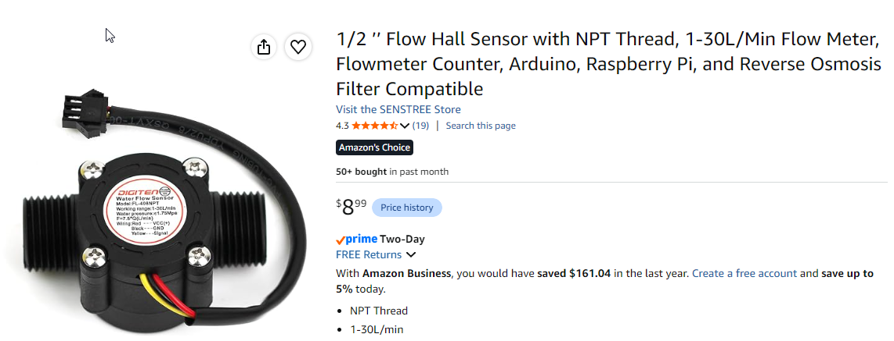
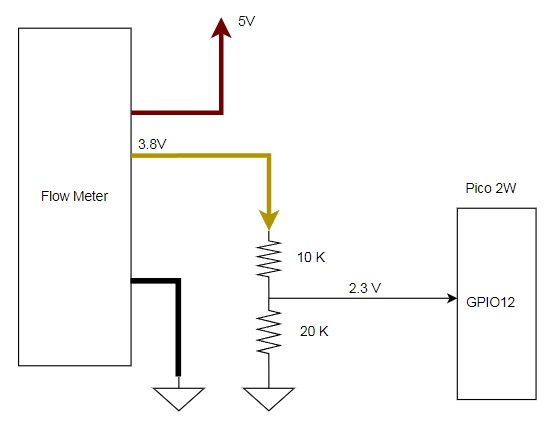
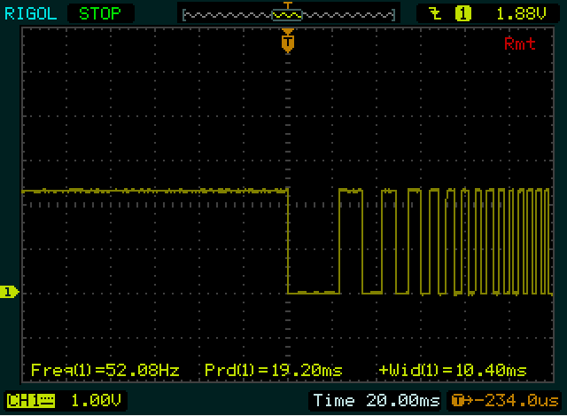
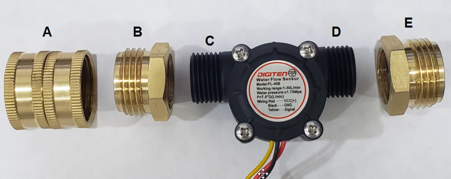
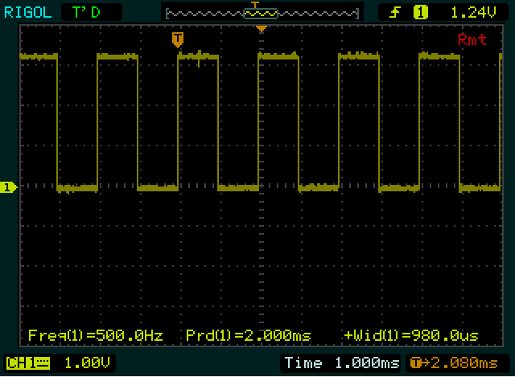
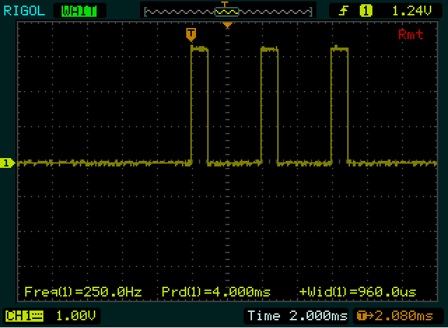
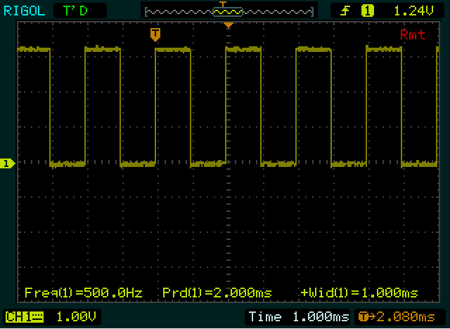
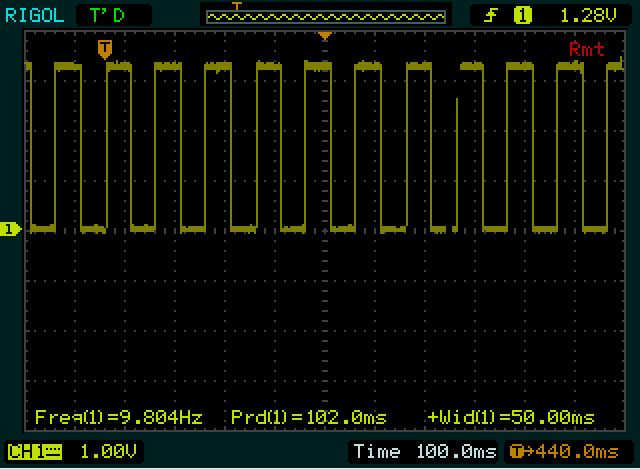
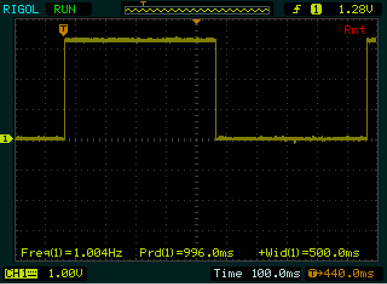

[Jump to Test](#test)

# FLOW METER
## Table of Contents
- [FLOW METER](#flow-meter)
  - [Table of Contents](#table-of-contents)
- [Water Flow Meter](#water-flow-meter)
    - [Specifications](#specifications)
    - [Product Information](#product-information)
- [Gallons Per Minute Calculation](#gallons-per-minute-calculation)
    - [Test](#test)
- [Flow Meter Electrical Interface](#flow-meter-electrical-interface)
- [Flow Meter Generated Pulses](#flow-meter-generated-pulses)
- [Flow Meter Hose Connections](#flow-meter-hose-connections)
- [Flow Meter Simulator](#flow-meter-simulator)
  - [Pulse Generator API](#pulse-generator-api)
    - [generate\_pulses(period\_ms, width\_ms, number\_of\_pulses = 0)](#generate_pulsesperiod_ms-width_ms-number_of_pulses--0)
    - [kill\_generate\_pulses()](#kill_generate_pulses)
    - [one\_khz\_interrupt(a\_call\_back\_function)](#one_khz_interrupta_call_back_function)
    - [kill\_one\_khz\_interrupt()](#kill_one_khz_interrupt)
    - [GenerateAsyncPulses(period\_in\_ms = DEFAULT\_PERIOD\_IN\_MS, width\_in\_ms = DEFAULT\_WIDTH\_IN\_MS):](#generateasyncpulsesperiod_in_ms--default_period_in_ms-width_in_ms--default_width_in_ms)
  - [API Examples](#api-examples)
    - [Example 1](#example-1)
    - [Example 2](#example-2)
    - [Example 3](#example-3)
    - [Example 4](#example-4)
    - [Example 5](#example-5)
- [Development Tools](#development-tools)
  - [mpremote](#mpremote)
  - [PowerShell Scripts](#powershell-scripts)
    - [compare\_pico.ps1](#compare_picops1)
    - [copy\_changed\_to\_pico.ps1](#copy_changed_to_picops1)
    - [diff\_pico\_file.ps1](#diff_pico_fileps1)
    - [copy\_file\_to\_pico.ps1](#copy_file_to_picops1)
    - [compare\_file\_to\_pico.ps1](#compare_file_to_picops1)
    - [run\_active\_file.ps1](#run_active_fileps1)
  
---
---
<div style="height: 200px;"></div>
# Water Flow Meter



### Specifications

| Property | Value |
|----------|-------|
| Model | SENSTREE Flow Meter |
| Connection | 3/4 inch |
| Flow Range | 0.264–7.92 GPM |
| Output | Pulse signal |
| Calibration | 450 pulses per liter |

### Product Information

[View Flow Meter on Amazon](https://www.amazon.com/dp/B0CC949527)

# Gallons Per Minute Calculation

Rated at 450 pulses/liter
1 Gallon = 3.78541 liters
450 (pulses/liter) * 3.78541 (liters/gallon) = 1703.4345 (pulses/gallon)

### Test
This is a test section.

# Flow Meter Electrical Interface
There is a divider so the voltage does not exceed 3.3V as required by the Pico2w GPIO pins.


# Flow Meter Generated Pulses



# Flow Meter Hose Connections



A)  
Female to Female Coupler: 3/4 inch double female thread on both ends. Both connect to garden hose with female end.  
[3/4"Female GHT to 3/4"Female GHT](https://www.amazon.com/dp/B09NHS3QJ3?ref=ppx_yo2ov_dt_b_fed_asin_title&th=1)  

B,E)  
G1/2" Female Thread (BSP) to 3/4 GHT Male  
[View BSP to GHT connectors](https://www.amazon.com/dp/B0FG7YW21X?ref=ppx_yo2ov_dt_b_fed_asin_title&th=1) 

C,D)   
1/2"G (BSP) male  
[View Flow Meter connectors on Amazon](https://www.amazon.com/dp/B0CC949527)


# Flow Meter Simulator
I created a pulse generator to simulate pulses from a flow meter. 

## Pulse Generator API
### generate_pulses(period_ms, width_ms, number_of_pulses = 0)  
> Generate pulses on pico's GP7 I/O line.   
Usage:  
generate_pulses(period_ms, width_ms, number_of_pulses = 0) 
period_ms - integer, minimum value is 2 msec.  
width_ms - integer, value < period_ms  
number_of_pulses - integer, specifies number of pulses, if = 0 then its a pulse waveform.  
**Beware:** Do not restart without killing the interrupt first, use kill_generate_pulses()

### kill_generate_pulses()  
In the PowerShell terminal call this function to kill the interrupt caused by generate_pulses() when number_of_pulses = 0. Note that this is not required if number_of_pulses > 0.

### one_khz_interrupt(a_call_back_function)
Generates an interrupt every 1 msec, a call back function is specified so that some processing can be done in the callback function. The actual pulse waveform is 500Hz, 50% duty cycle.

### kill_one_khz_interrupt()
In the PowerShell terminal call this function to kill the interrupt caused by kill_one_khz_interrupt().

### GenerateAsyncPulses(period_in_ms = DEFAULT_PERIOD_IN_MS, width_in_ms = DEFAULT_WIDTH_IN_MS):
Generates a pulse waveform without using interrupts.

## API Examples
### Example 1  
PERIOD_IN_MS = 2  
WIDTH_IN_MS = 1  
NUMBER_OF_PULSES = 0 # continuous  
generate_pulses(PERIOD_IN_MS,WIDTH_IN_MS, NUMBER_OF_PULSES)

  

### Example 2  
PERIOD_IN_MS = 4  
WIDTH_IN_MS = 1  
NUMBER_OF_PULSES = 3  
generate_pulses(PERIOD_IN_MS,WIDTH_IN_MS, NUMBER_OF_PULSES)  
  

### Example 3
millisecond_counter = 0  
def this_function_is_a_callback():  
>    global millisecond_counter  
    millisecond_counter += 1  
    
some_counter = 0  
one_khz_interrupt(this_function_is_a_callback)  
while 1:  
>    sleep(1)  
    print("some_counters=",some_counter, "    milliseconds counter = ", millisecond_counter)  
    some_counter += 1  

  

### Example 4
PERIOD_IN_MS = 100  
WIDTH_IN_MS = 50  
GenerateAsyncPulses(PERIOD_IN_MS, WIDTH_IN_MS) # Note it does not return!    
    
  
    


### Example 5
The following defaults to period = 1000 msecs, and width = 500 msec  
GenerateAsyncPulses() # Note it does not return!  
    

# Development Tools
I developed scripts to interact with the Pico from VsCode using mpremote.exe. Since I use VsCode as the editor, I decided edit and run pico files from VsCode.    
NB All editing is done in VsCode in the directory local_master_pico and then file is downloaded to the pico file system.

## mpremote
is used to communicate to the PICO2W using PowerShell. PowerShell is used as the terminal in VsCode. With mpremote running from PowerShell is similar to running REPL in Thonny.
```
mpremote --version
(env_micro_python) PS F:\projects\tech_farm\tech_farm_nodes> mpremote --version
mpremote 1.25.0

(env_micro_python) PS F:\projects\tech_farm\tech_farm_nodes> mpremote
Connected to MicroPython at COM17
Use Ctrl-] or Ctrl-x to exit this shell

 >>>

>>> import sys
>>> print(sys.version)
3.4.0; MicroPython v1.25.0-preview.49.g0625f07ad.dirty on 2024-11-21
>>>
```
## PowerShell Scripts
These scripts are accessible in VsCode's status bar at the bottom of the VsCode Window.

### compare_pico.ps1
Compares files in local_master_pico to files on pico2w  
VsCode status bar text: =? Compare Pico
### copy_changed_to_pico.ps1
Copies changed/new files from local_master_pico to pico2w  
VsCode status bar text: => Update Pico
### diff_pico_file.ps1
Does a diff between the active file being edited in VsCode to the file on the pico2w  
VsCode status bar text: <> Diff Pico File
### copy_file_to_pico.ps1
Copy the active file from local_master_pico to the pico2w  
VsCode status bar text: =1 Copy Active File to Pico
### compare_file_to_pico.ps1
Compare the active file to the corresponding file on the pico2w  
VsCode status bar text: ?1 Compare File to Pico
### run_active_file.ps1
Run the active file on pico2w
VsCode status bar text: ## Run Active File on Pico  
